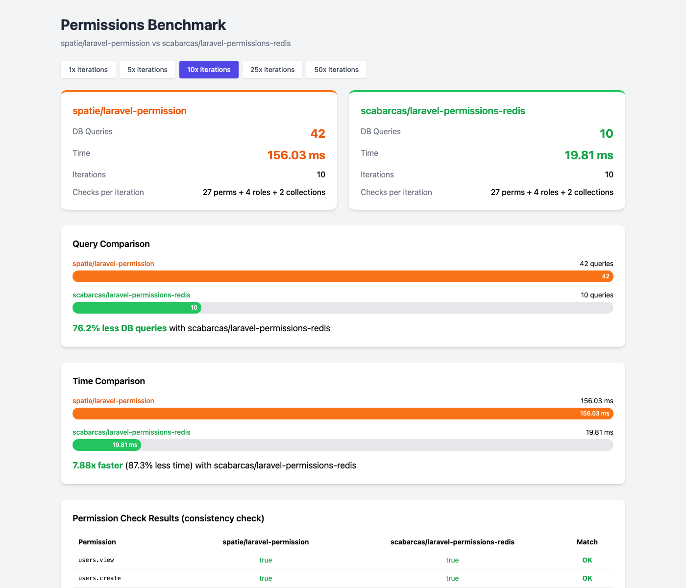
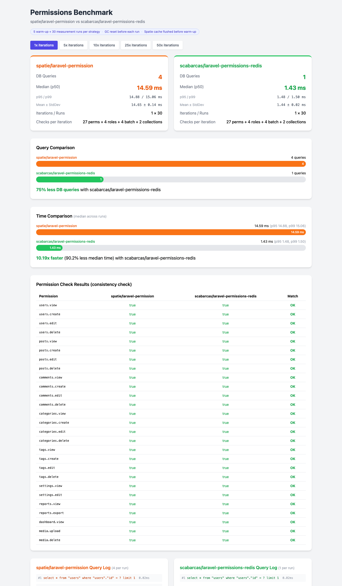
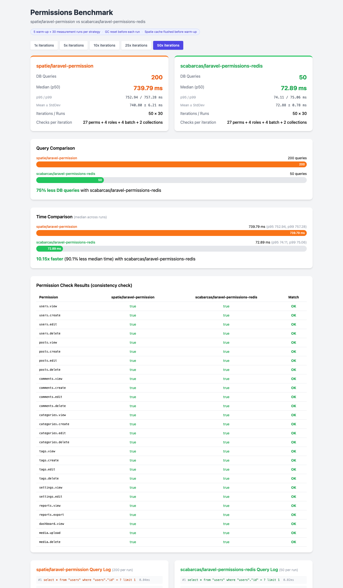
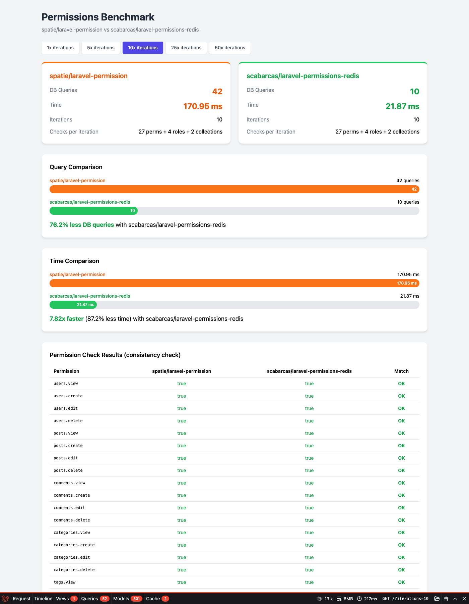

# Laravel Permissions Benchmark

Five ways to resolve roles and permissions in Laravel, run on the same data and the same request: a query per check, [spatie/laravel-permission](https://github.com/spatie/laravel-permission) as installed, Spatie with eager loading, Spatie with a per-user `Cache::remember()`, and [scabarcas/laravel-permissions-redis](https://github.com/scabarcas17/laravel-permissions-redis). Each run reports SQL queries, Redis commands and wall-clock time, with MySQL and Redis on the same Docker network or behind a fixed added latency.

Tested against:
- `scabarcas/laravel-permissions-redis` **4.3.0**, through the `feat/v4.3.0` branch of the VCS repository in `composer.json` until it is tagged; **4.2.0** for the before-and-after row
- `spatie/laravel-permission` **7.2.4**
- Laravel 13.2 on PHP 8.4 (the Docker image)

## The strategies

| # | Strategy | How a check is answered |
|---|---|---|
| 1 | Query per check | A hand-rolled `Gate::before()`: one EXISTS query per check, nothing cached |
| 2 | spatie/laravel-permission | The permission registry is cached; the user's roles and permissions are Eloquent relations loaded on the first check of each request |
| 3 | Spatie + eager loading | The same, with `loadMissing(['roles.permissions', 'permissions'])` right after the user lookup |
| 4 | Spatie + `Cache::remember()` | The user's role and permission names, cached per user in the Redis cache store; checks are answered from those arrays |
| 5 | laravel-permissions-redis | Per-user Redis SETs; the first check of a request reads them and the rest are answered in memory |

All five read the same tables and the same seeded user. The dashboard's consistency table, or an error line from `bench:markdown`, shows whether any of them answered differently.

## Methodology

Per strategy and iteration count: 5 warm-up runs, then one untimed run that counts SQL queries (`DB::enableQueryLog()`) and Redis commands (`CommandExecuted` events on the `default` and `cache` connections), then 30 timed runs with all logging off and `gc_collect_cycles()` before each. Spatie's registry cache is flushed before every strategy's warm-up.

Each iteration models one request: a fresh user model and empty in-process caches (the Redis package's resolver is flushed), while Spatie's registry, the `Cache::remember()` entries and the Redis SETs stay warm, as they would between requests. Spatie's registry stays in PHP memory between iterations instead of being read back from the cache store; that favours Spatie slightly.

The request: 27 `hasPermissionTo()` calls, 4 `hasRole()` calls (one for a role that does not exist), `hasAnyRole`, `hasAllRoles`, `hasAnyPermission`, `hasAllPermissions`, then `getAllPermissions()` and `getRoleNames()`. The seeded user holds `admin` and `editor` plus one direct permission, so every permission check is true.

## Results

Docker on Apple Silicon (`docker-compose.yml` plus `docker-compose.latency.yml`): PHP 8.4 with phpredis, MySQL 8.4 and Redis 7, both behind toxiproxy. Median of three `bench:markdown 1 --warm=5 --runs=30` executions per condition.

### Round trips per request

Counted, not timed, so they hold on any hardware. With Laravel's default native prepared statements a MySQL query takes two round trips: prepare, then execute.

| Strategy | SQL queries | Redis commands | Round trips |
|---|:---:|:---:|:---:|
| Query per check | 41 | 0 | 82 |
| spatie/laravel-permission | 4 | 0 | 8 |
| Spatie + eager loading | 4 | 0 | 8 |
| Spatie + `Cache::remember()` | 1 | 1 | 3 |
| laravel-permissions-redis 4.3.0 | 1 | 2 | 4 |
| laravel-permissions-redis 4.2.0 | 1 | 67 | 69 |

### Wall-clock per request

`+0 ms` goes through toxiproxy without adding delay. `+1 ms` delays every response from MySQL and Redis by 1 ms (`php artisan bench:latency 1`), which comes to about 1.5 ms per round trip in this setup.

| Strategy | p50, +0 ms | p95, +0 ms | p50, +1 ms | p95, +1 ms |
|---|:---:|:---:|:---:|:---:|
| Query per check | 12.20 ms | 12.55 ms | 147.01 ms | 177.36 ms |
| spatie/laravel-permission | 3.30 ms | 3.44 ms | 15.77 ms | 18.77 ms |
| Spatie + eager loading | 3.27 ms | 3.44 ms | 15.25 ms | 16.12 ms |
| Spatie + `Cache::remember()` | 0.36 ms | 0.40 ms | 4.46 ms | 5.41 ms |
| laravel-permissions-redis 4.3.0 | 0.65 ms | 0.68 ms | 6.16 ms | 8.76 ms |
| laravel-permissions-redis 4.2.0 | 6.15 ms | 6.27 ms | 106.57 ms | 119.16 ms |

For the 4.2.0 row the package's source was swapped in the container for the `v4.2.0` tag. With the delay on, executions vary from one to the next (toxiproxy under Docker Desktop): across them the 4.3.0 p50 went from 5.53 to 8.01 ms and Spatie's from 15.00 to 15.78 ms.

> **What decides the order is round trips.** Without added delay, Spatie's cost is mostly PHP (hydrating the relations and scanning collections), and the query-per-check strategy pays for 41 short queries. With 1 ms per response, each strategy pays roughly its round-trip count times 1.5 ms. Eager loading removes no queries: `loadMissing(['roles.permissions', 'permissions'])` issues the same three relation queries as the lazy path. A per-user `Cache::remember()` is the fastest read because it is one GET, and it leaves keeping that entry in step with role changes to the application. 4.2.0 sent an EXISTS and a SISMEMBER per distinct check, so it fell behind Spatie as soon as Redis was more than a loopback away; 4.3.0 reads both of the user's sets in one EVAL on the first check, plus an HMGET for `getAllPermissions()`.

Earlier versions of this README reported about 10x at p50 between Spatie (14.27 ms) and the Redis package (1.44 ms) on SQLite with a local Redis. That gap does not reproduce with the current harness: a run on SQLite (PHP 8.5, predis, Redis in Docker) measured Spatie at 2.31 ms, not 14.27 ms. The tables above replace those numbers.

## Run it

### Docker, MySQL and adjustable latency

```bash
git clone https://github.com/scabarcas17/laravel-permissions-redis-benchmark.git
cd laravel-permissions-redis-benchmark

export COMPOSE_FILE=docker-compose.yml:docker-compose.latency.yml
docker compose up -d --build

docker compose exec app php artisan bench:latency 0
docker compose exec app php artisan bench:markdown 1 --warm=5 --runs=30

docker compose exec app php artisan bench:latency 1
docker compose exec app php artisan bench:markdown 1 --warm=5 --runs=30
```

`bench:latency {ms}` sets the delay toxiproxy adds to every response from MySQL and Redis (whole milliseconds; `0` removes it). The dashboard is at **http://localhost:8080**, with an iteration selector.

### Docker, SQLite

```bash
docker compose up -d
```

Open **http://localhost:8080**.

### Local

Requires PHP 8.4+, Composer and a Redis server on localhost:6379.

```bash
git clone https://github.com/scabarcas17/laravel-permissions-redis-benchmark.git
cd laravel-permissions-redis-benchmark

composer install
cp .env.example .env
php artisan key:generate
php artisan migrate:fresh --seed --seeder=BenchmarkSeeder
php artisan bench:markdown 1 --warm=5 --runs=30
php artisan serve --port=8080
```

## How it works

- `SpatieUser` (Spatie's `HasRoles`), `RedisUser` (`HasRedisPermissions`) and the plain `User` share the `users` table and the `App\Models\User` morph type, so every strategy reads the same pivot rows.
- Each strategy is a class in `app/Benchmark` implementing `PermissionBenchmark`; `AppServiceProvider` lists them in the order above.
- `RedisCommandCounter` switches Redis command events on for the counting run only, so the timed runs pay nothing for it.
- The seeder warms the Redis package's sets for the user, as a login would.

## Screenshots

From the two-strategy version of the dashboard.

### Dashboard Overview (10 iterations)


### Full Comparison (1 iteration)


### Full Comparison (50 iterations)


### Debugbar Integration


## Tech Stack

- Laravel 13, PHP 8.4 (Docker image)
- spatie/laravel-permission 7.2.4
- scabarcas/laravel-permissions-redis 4.3.0 (`feat/v4.3.0` until it is tagged)
- MySQL 8.4 or SQLite, Redis 7, toxiproxy 2.9
- barryvdh/laravel-debugbar for the dashboard

## What this bench does not cover yet

- Wildcard permissions (`posts.*`)
- Writes: what a role or permission change costs, and how each strategy invalidates
- The Octane request lifecycle
- Concurrent users (one user, one process)
- PostgreSQL
- A user without broad roles: here every permission check is true

## License

MIT
